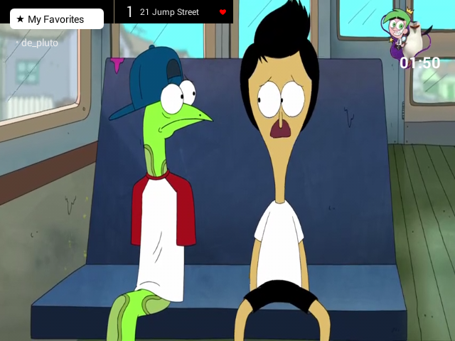
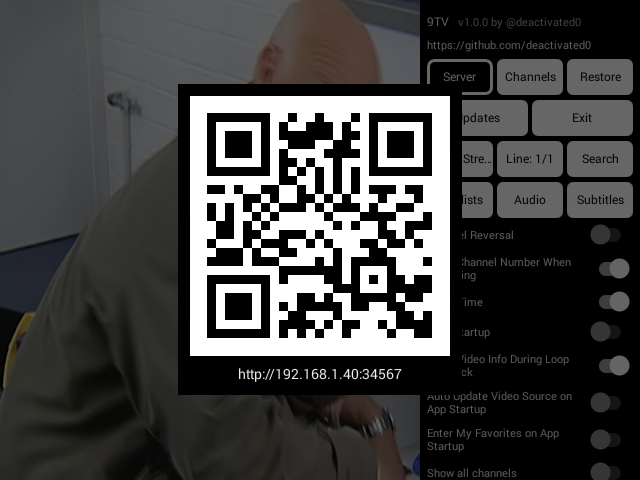
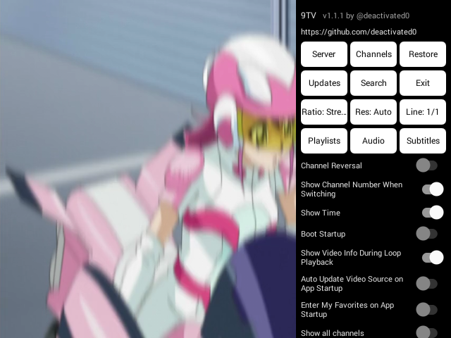

# 9TV

**9TV** is a high-performance, lightweight, universal IPTV and Network TV streaming player engineered for **all Android devices** — from retro handhelds (such as the **R36S** 4:3 640x480 console) and legacy Android 4.0–4.4 KitKat TV boxes/tablets to modern Android TV, Google TV, FireTV sticks, phones, tablets, and emulators running up to Android 17 (API 36/37).

Crafted with zero preloaded bloatware, native adaptive resolution selector (defaults to native display resolution), responsive 4:3 / 16:9 aspect ratio scaling without Surface tearing, true AMOLED Black & Clean Light themes with solid white button tiles, local file chooser import, multi-playlist studio, and rock-solid continuous playback.

**Target Hardware**: All Android devices (Android TV, Google TV, FireTV, TV boxes, phones, tablets, retro handhelds like R36S, emulators)  
**Author / Developer**: @deactivated0 ([GitHub](https://github.com/deactivated0/9TV))  
**Package ID**: `com.deactivated0.tv9`  
**OS Support**: Android 4.0 (API 14) – Android 17 (API 36/37)

---

## Real Screenshots (Captured from R36S running Android 4.4)

| Channel Menu & Groups | Playlist Manager & File Chooser |
| :---: | :---: |
|  |  |

| Settings Menu (White Accents) | Fullscreen 4:3 Playback |
| :---: | :---: |
|  |  |

---

## Releases & Architectures

Pre-built standalone release APKs are provided in `releases/` for all architectures:

| Architecture | APK File | Target Devices |
| :--- | :--- | :--- |
| **ARMv7 (32-bit)** | [`releases/app-armeabi-v7a-release.apk`](releases/app-armeabi-v7a-release.apk) | **R36S Handheld Console**, Android 4.4 KitKat TV boxes, ARMv7 devices |
| **ARM64 (64-bit)** | [`releases/app-arm64-v8a-release.apk`](releases/app-arm64-v8a-release.apk) | Modern Android TV, Google TV, FireTV, modern phones & tablets |
| **x86 (32-bit)** | [`releases/app-x86-release.apk`](releases/app-x86-release.apk) | 32-bit Intel/AMD TV boxes, legacy x86 tablets, emulators |
| **x86_64 (64-bit)** | [`releases/app-x86_64-release.apk`](releases/app-x86_64-release.apk) | 64-bit Intel/AMD Android, ChromeOS, modern Android emulators |
| **Universal** | [`releases/app-universal-release.apk`](releases/app-universal-release.apk) | Universal all-in-one build (contains all CPU architectures) |

---

## Key Features & Optimizations

- **Universal Multi-Device Support & Resolution Selector**:
  - Automatically matches native display resolution (480p on R36S, 1080p on TV/phone, up to 4K).
  - Built-in resolution switcher: **Native (Auto)**, **360p**, **480p**, **720p**, **1080p**, and **Max**.
  - Intelligent hardware decoder fallback with automatic software codec failover.
- **Engineered for R36S & All Aspect Ratios**:
  - Custom UI layouts tuned for 4:3 (640x480) handhelds, TV boxes, and full widescreen displays.
  - Sizing handled strictly within `AspectRatioFrameLayout`, completely eliminating Surface destruction/recreation, flickering, and frame tearing when changing aspect ratios.
- **Continuous, Stutter-Free Live Playback**:
  - **No Stream Dropping**: Startup timeout timer cancels immediately upon playback start; live edge resynchronization on `ERROR_CODE_BEHIND_LIVE_WINDOW` prevents stream disconnects.
  - **Wake Lock Protection**: CPU and network wake lock (`WAKE_MODE_NETWORK`) prevents hardware sleeping during live streams.
  - **Zero Back-Buffer Memory Purging**: Immediately purges historical frames (`setBackBuffer(0, false)`) to prevent Dalvik GC pauses on low-memory 512MB/1GB hardware.
  - **Extended Connection Resilience**: 15s connect and 20s read timeouts for resilient live chunk streaming.
- **Advanced Multi-Playlist Studio**:
  - Built-in local filesystem browser (browse `/sdcard`, internal storage, USB) with instant `.m3u`, `.m3u8`, `.txt`, `.json` import.
  - Highlighted focus buttons and clear text formatting across all dialogs.
  - Support for local files, remote URLs, and raw playlist text.
  - Built-in LAN web server configuration portal (port 34567) to push playlists from any PC/phone browser.
- **Aspect Ratio Controls**:
  - Instant cycling between **4:3**, **16:9**, **Original Fit**, **Stretch Fullscreen**, and **Zoom Crop**.
- **AMOLED Black & Pure White Themes**:
  - Solid white button tiles with high-contrast borders for Dark Mode.
  - Solid black button tiles with high-contrast borders for Light Mode.
  - White-accented smooth toggle switches.
- **Clean Navigation & Privacy**:
  - Zero preloaded bloatware or third-party ads.
  - Completely removed donation buttons and clean, lean menus.
  - Silent EPG error handling without popup toasts.

---

## Controls (Gamepad / Remote / Touch)

| Action | Handheld Gamepad / Remote | Touchscreen |
| :--- | :--- | :--- |
| **Open Channel List & Groups** | `D-Pad Left` / `B` | Single Tap Left Screen |
| **Open Settings Menu** | `D-Pad Right` / `Start` / `Menu` | Double Tap Right Screen |
| **Switch Channels** | `D-Pad Up` / `D-Pad Down` | Swipe Up / Down |
| **Select / Play Channel** | `D-Pad Center` / `A` / `Enter` | Tap Channel Item |
| **Cycle Aspect Ratio** | Select "Ratio" button in Settings | - |
| **Close Menu / Back** | `Back` / `B` | Tap Dark Backdrop |

---

## Building from Source

```bash
# Clone the repository
git clone https://github.com/deactivated0/9TV.git
cd 9TV

# Build all 5 release APKs
./gradlew assembleRelease
```

---

## Sideload via ADB to R36S

```bash
# Sideload ARMv7 release build:
adb install -r releases/app-armeabi-v7a-release.apk

# Launch app:
adb shell am start -n com.deactivated0.tv9/.MainActivity
```

---

## License

This project is open-source under the MIT License. See [LICENSE.txt](LICENSE.txt) for details.  
Copyright (c) 2025-2026 Deactivated0.
